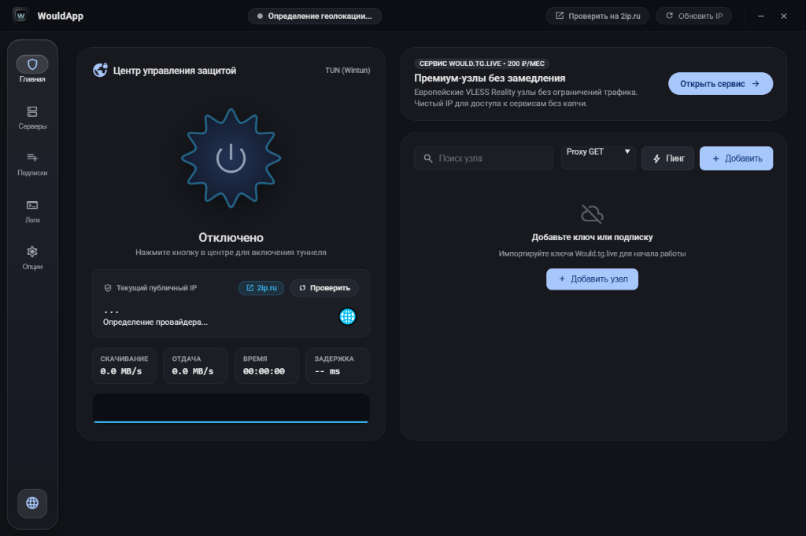
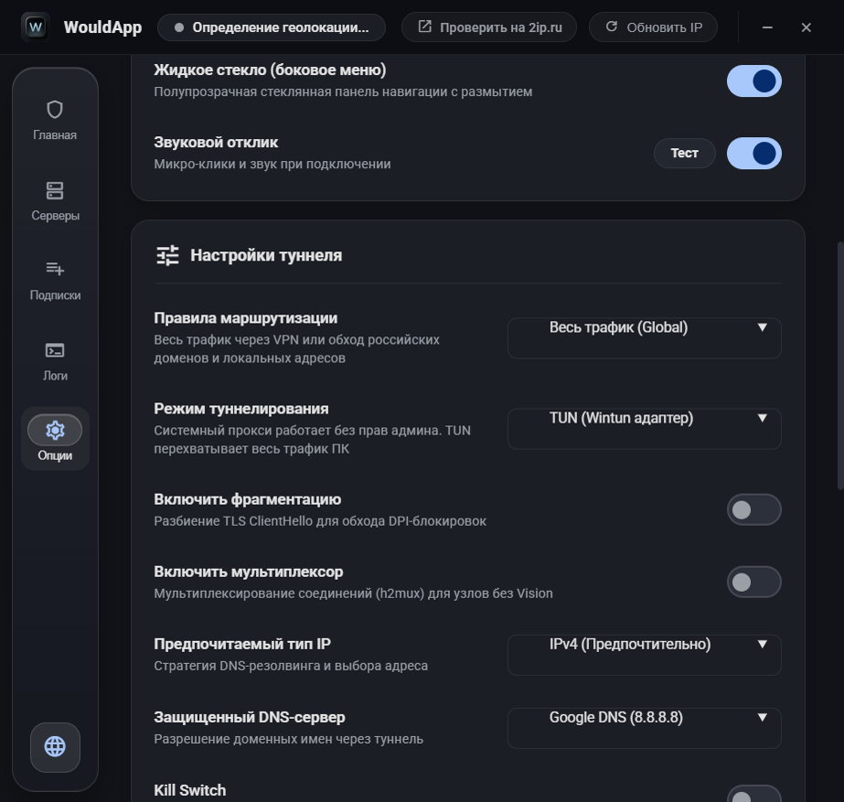

# WouldApp — Windows VPN-клиент на sing-box

[](LICENSE)
[](package.json)
[](https://github.com/SagerNet/sing-box)
[](https://www.microsoft.com/windows)

**WouldApp** — нативный десктопный VPN-клиент для Windows на ядре **sing-box 1.14.4** с интерфейсом в стиле **Material Design 3** и эффектом жидкого стекла. Работает как самостоятельное приложение (Electron) с системным треем, проверкой реальной работы туннеля и управлением подписками.

Скачать готовую сборку: **[Releases (v0.1.0 Beta)](https://github.com/Malt0pov/wouldapp/releases/tag/v0.1.0-beta)**

---

## Скриншоты

| Главный экран | Настройки туннеля и интерфейса |
|---|---|
|  |  |

---

## Возможности

### Протоколы и транспорт
- **VLESS** — Reality, TLS + uTLS-отпечаток, ALPN, flow (`xtls-rprx-vision`).
- **Trojan** — TLS, Reality, ALPN.
- **Shadowsocks** — включая методы SS2022.
- **Hysteria2** — включая `obfs` (`salamander`), `alpn`, `insecure`.
- **Транспорты:** WebSocket, gRPC, HTTPUpgrade, HTTP/2 (`http`).
- *Примечание:* транспорты `xhttp` (`SplitHTTP`) и `tuic://` ядром `sing-box 1.14.4` в текущей бета-версии не поддерживаются (клиент предупредит при попытке подключения).

### Подписки и серверы
- Импорт ссылок `vless://`, `trojan://`, `ss://`, `hysteria2://` (`hy2://`), пачек ключей, base64 и JSON-конфигов.
- Автоопределение названия подписки из заголовка `profile-title` (или домена).
- Группировка серверов по подпискам с разворачиванием по кнопке домика и удалением всей подписки целиком.
- Цветные SVG-флаги стран для всех узлов и поиск по названию, IP, протоколу или подписке.

### Реальная проверка пинга и туннеля
- **Два метода пинга на выбор:**
  - **Via Proxy GET** (по умолчанию) — сквозная проверка через временный `sing-box` (`generate_204`), работает для всех протоколов, включая **Hysteria2 (UDP)** и **VLESS Reality**.
  - **TCP Ping** — быстрая проверка доступности TCP-порта.
- **Проверка при подключении:** клиент проверяет реальное прохождение трафика через туннель и не показывает ложный статус «Подключено», если ключ узла устарел или сервер не отвечает.

### Сеть и безопасность
- **Два режима работы:**
  - **Системный прокси Windows** — работает сразу без прав администратора.
  - **TUN (Wintun)** — перехватывает весь IP-трафик ПК. Если приложение запущено без прав администратора, при выборе TUN клиент предложит перезапуск через UAC и сам подключится к выбранному серверу.
- **Гибкие настройки туннеля:** правила маршрутизации (*Весь трафик* / *Обход РФ и LAN* / *Напрямую*), TLS-фрагментация, мультиплексор (`h2mux`), выбор стратегии IPv4/IPv6, выбор DNS (Google, Cloudflare, Quad9, AdGuard), **Kill Switch**, разрешение подключений из LAN.
- **Живая телеметрия и логи:** скорость приёма/отдачи в реальном времени (`B/s`, `KB/s`, `MB/s`), график, системный трей и консоль `sing-box`.

### Персонализация (Material Design 3)
- Темы поверхности (*Графит M3*, *AMOLED Black*, *Тёмно-синяя*), 6 акцентных цветов.
- Опциональный эффект **Жидкое стекло** для боковой панели навигации.
- 5 вариантов геометрии центральной кнопки подключения из MD3 (*Волна*, *Круг*, *Сквиркл*, *Клевер*, *Гексагон*).

---

## Установка и запуск (для пользователей)

1. Перейдите в **[Releases](https://github.com/Malt0pov/wouldapp/releases/tag/v0.1.0-beta)** и скачайте архив **`WouldApp-v0.1.0-beta-win-x64.zip`**.
2. Распакуйте архив в любую удобную папку.
3. Запустите **`WouldApp.exe`**.
   - *Примечание про Windows SmartScreen:* так как бета-сборка пока не имеет коммерческой цифровой подписи, при первом запуске Windows может показать окно защиты. Нажмите **«Подробнее» → «Выполнить в любом случае»**.
4. Для создания ярлыка с иконкой на рабочем столе нажмите **Опции → Дополнительные настройки → «Создать ярлык»**.

---

## Запуск из исходников (для разработчиков)

```bash
git clone https://github.com/Malt0pov/wouldapp.git
cd wouldapp
npm install
```

Поместите в папку `bin/` бинарники `sing-box.exe` (1.14.x), `wintun.dll` и `proxy_helper.exe`, затем:

```bash
npm start          # Запуск Electron-приложения
npm run dev:server # Автономный веб-режим на http://127.0.0.1:3005
npm run check      # Проверка синтаксиса main.js, preload.js, server.js
npm test           # Базовый набор тестов (test-core.js)
```

---

## Лицензия

Проект распространяется по лицензии **MIT**. Подробнее — в [LICENSE](LICENSE).  
Автор: [Malt0pov](https://github.com/Malt0pov) • Репозиторий: [github.com/Malt0pov/wouldapp](https://github.com/Malt0pov/wouldapp)
